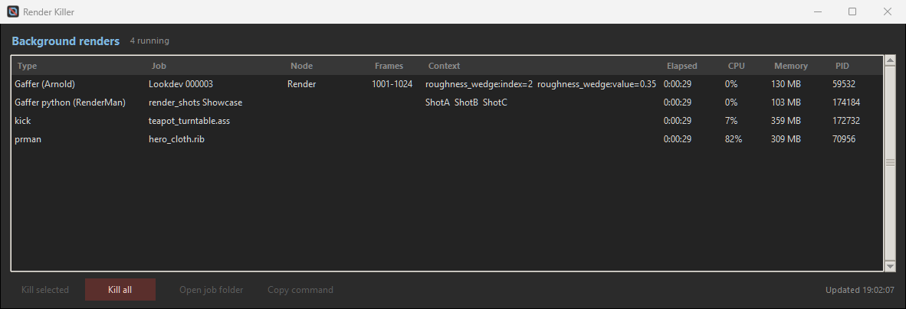

# Render Killer

A small Windows app that lists Gaffer background renders and standalone `kick` and `prman` renders, and kills them.

It picks up Gaffer dispatcher tasks (`gaffer execute`), scripted Gaffer renders (`gaffer python` and `gaffer dispatch`), and command-line or LocalQueue `prman` and `kick` runs. Gaffer renders Arnold and RenderMan inside its own process, so each Gaffer row is labelled with the renderer it has loaded, for example "Gaffer python (RenderMan)".

Run `dist\RenderKiller.exe` (or `Render Killer.lnk`). The exe is self-contained, so you can copy it anywhere. To run from source, use `pyw -3.14 render_killer.pyw`. The source uses only the Python standard library.

To rebuild the exe after changing the source, run `build.bat`. The first run creates a `.venv` with PyInstaller.

- The list refreshes every 2 seconds. It shows the job (script name and LocalDispatcher job number), node, frames, context variables such as wedge values, elapsed time, CPU and memory.
- **Kill selected** (or the Delete key) and **Kill all** end each render's whole process tree, after asking you to confirm. Gaffer then marks the job as failed and doesn't start its remaining tasks, the same as cancelling it in the Local Jobs panel.
- Double-click a row, or use **Open job folder**, to open the dispatcher job directory. **Copy command** copies the `gaffer execute` command line, so you can rerun a single task by hand.

Interactive renders run inside the Gaffer GUI process, so they don't appear in the list.
